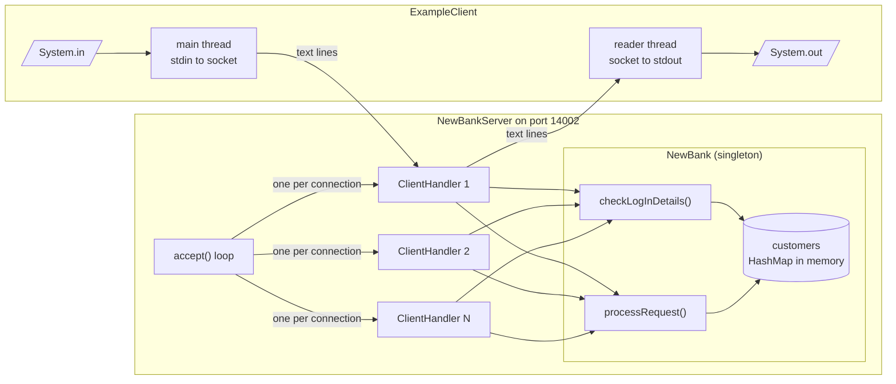
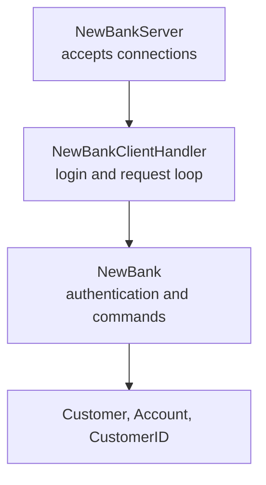
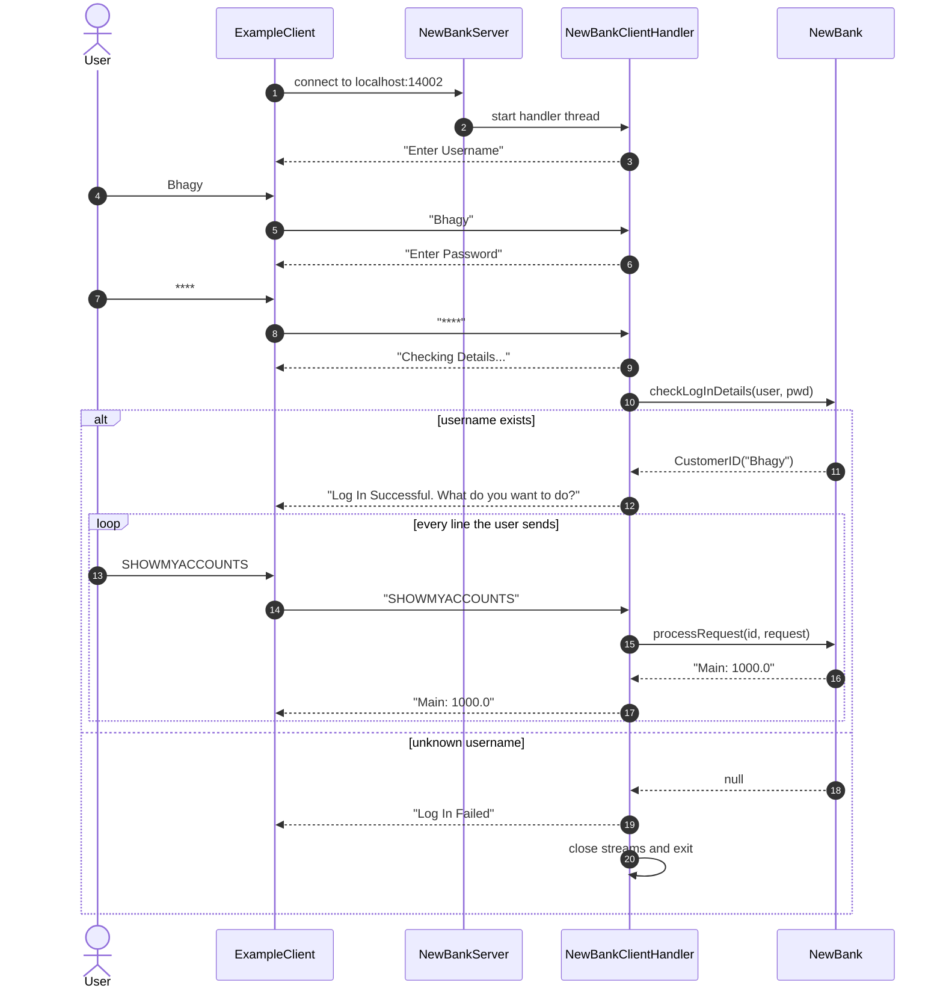
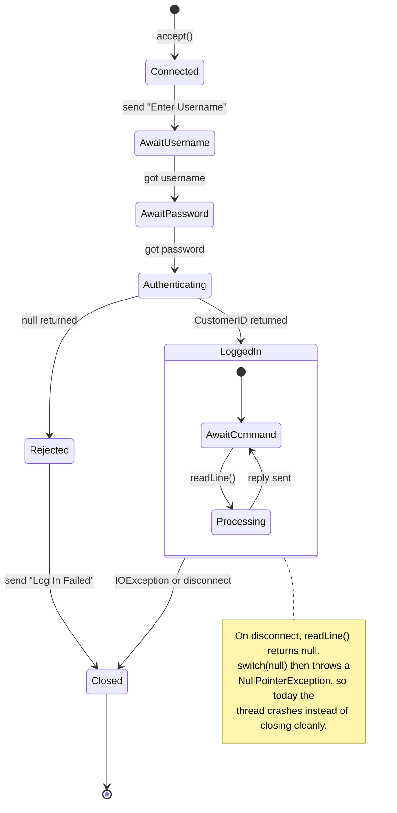
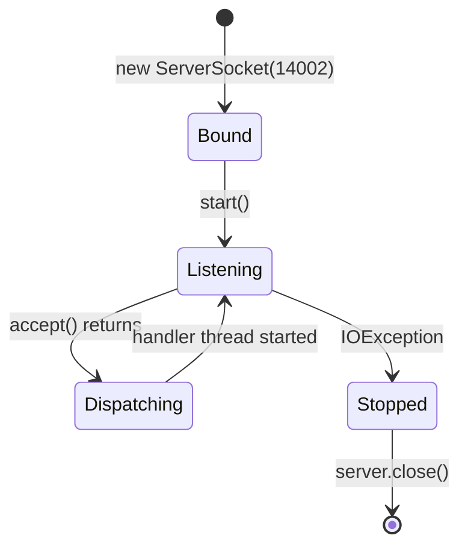
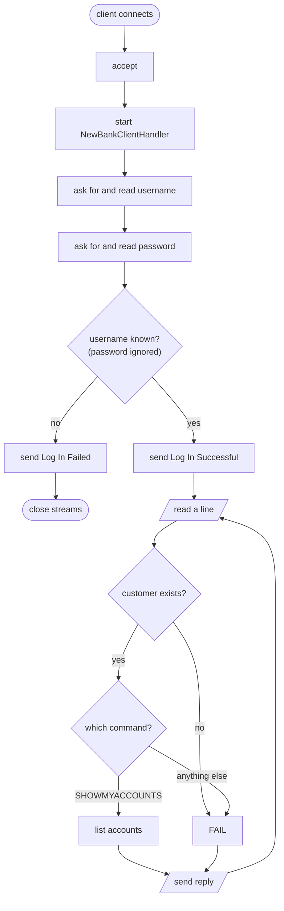
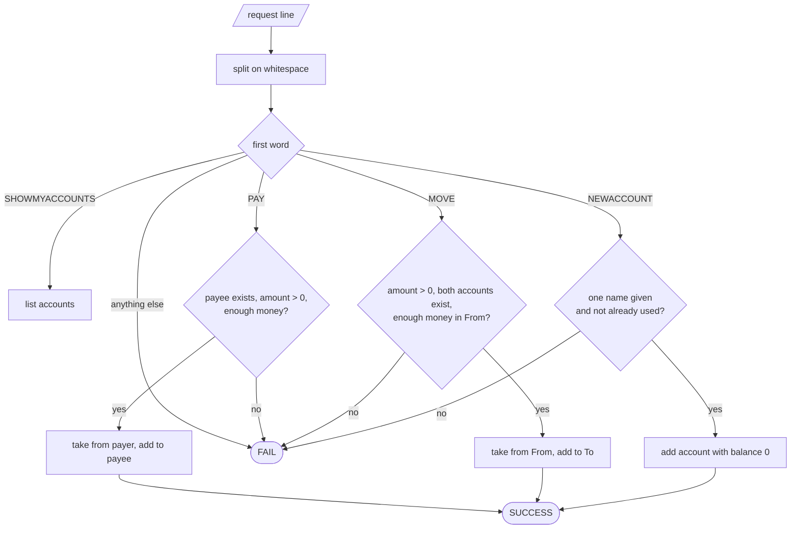
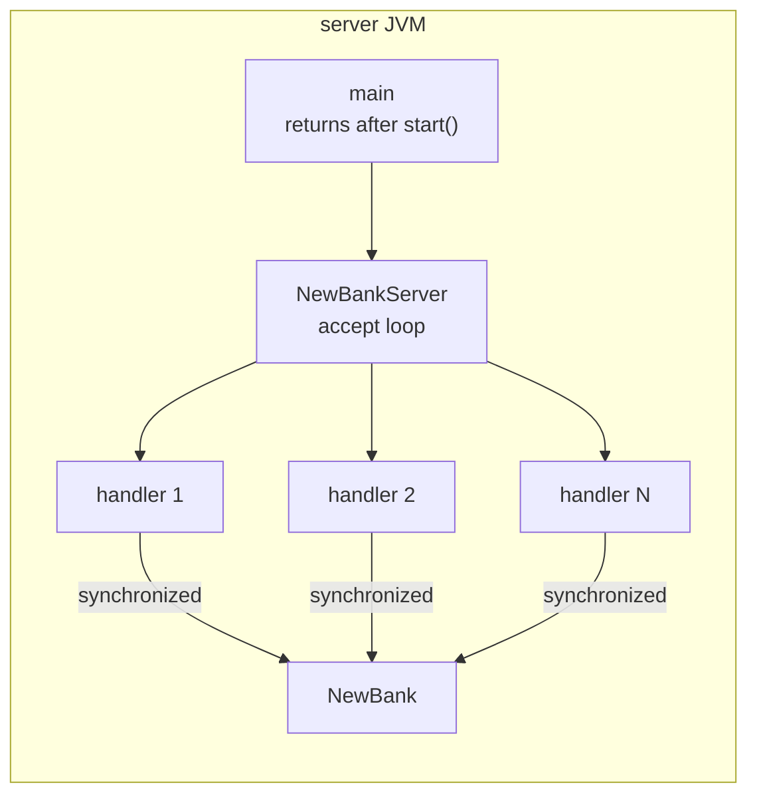

# NewBank

A small bank client and server written with plain Java sockets. The server listens on port 14002, gives each connection its own thread, asks for a username and password, then reads commands one line at a time.

The protocol in [protocol.txt](protocol.txt) lists four commands. Only `SHOWMYACCOUNTS` is implemented so far.

## Contents

- [Layout](#layout)
- [Running it](#running-it)
- [Protocol](#protocol)
- [Architecture](#architecture)
- [Classes](#classes)
- [A session, step by step](#a-session-step-by-step)
- [States](#states)
- [Request handling](#request-handling)
- [Threads](#threads)

## Layout

```text
bath_new_bank/
├── protocol.txt
└── newbank/
    ├── client/
    │   └── ExampleClient.java
    └── server/
        ├── NewBankServer.java
        ├── NewBankClientHandler.java
        ├── NewBank.java
        ├── Customer.java
        ├── Account.java
        └── CustomerID.java
```

| Class | What it does |
|---|---|
| `NewBankServer` | Opens `ServerSocket(14002)` and loops on `accept()`, starting a `NewBankClientHandler` for each connection. |
| `NewBankClientHandler` | Runs the login prompts, then reads requests in a loop and writes back the replies. |
| `NewBank` | Singleton holding all customers in a `HashMap<String, Customer>`. Handles login and command dispatch; both methods are `synchronized`. |
| `Customer` | A list of `Account`s. |
| `Account` | An account name and a `double` balance (the field is called `openingBalance`). |
| `CustomerID` | Wraps the username. Handed out on login and passed with every request. |
| `ExampleClient` | Console client. The main thread sends what you type; a second thread prints whatever the server sends back. |

### Test data

`NewBank.addTestData()` creates three customers at startup. Nothing is saved, so every restart starts from the same data.

| Username | Account | Balance |
|---|---|---|
| `Bhagy` | Main | 1000.0 |
| `Christina` | Savings | 1500.0 |
| `John` | Checking | 250.0 |

## Running it

You need JDK 8 or later. There are no dependencies and no build tool.

```bash
javac -d out newbank/server/*.java newbank/client/*.java

# terminal 1
java -cp out newbank.server.NewBankServer

# terminal 2
java -cp out newbank.client.ExampleClient
```

A session looks like this (lines starting with `>` are typed by you):

```text
Enter Username
> Bhagy
Enter Password
> whatever
Checking Details...
Log In Successful. What do you want to do?
> SHOWMYACCOUNTS
Main: 1000.0
> NEWACCOUNT Savings
FAIL
```

The password isn't checked yet, so anything works. `nc localhost 14002` works just as well as the example client.

## Protocol

Everything is plain text over TCP, one message per line. After the username and password lines, each command you send gets exactly one line back. Commands must match exactly, including case, so `showmyaccounts` gets `FAIL`.

| Command | Example | Reply | Implemented |
|---|---|---|---|
| `SHOWMYACCOUNTS` | `SHOWMYACCOUNTS` | Accounts and balances, e.g. `Main: 1000.0` | Yes |
| `NEWACCOUNT <Name>` | `NEWACCOUNT Savings` | `SUCCESS` or `FAIL` | No, always `FAIL` |
| `MOVE <Amount> <From> <To>` | `MOVE 100 Main Savings` | `SUCCESS` or `FAIL` | No, always `FAIL` |
| `PAY <Person/Company> <Amount>` | `PAY John 100` | `SUCCESS` or `FAIL` | No, always `FAIL` |

## Architecture



Seen as layers, each class only talks to the one below it:



## Classes

```mermaid
classDiagram
    direction LR

    class NewBankServer {
        -ServerSocket server
        +NewBankServer(int port)
        +run()
        +main(String[] args)$
    }
    class NewBankClientHandler {
        -NewBank bank
        -BufferedReader in
        -PrintWriter out
        +NewBankClientHandler(Socket s)
        +run()
    }
    class NewBank {
        -NewBank bank$
        -HashMap~String,Customer~ customers
        -NewBank()
        -addTestData()
        +getBank()$ NewBank
        +checkLogInDetails(String userName, String password) CustomerID
        +processRequest(CustomerID customer, String request) String
        -showMyAccounts(CustomerID customer) String
    }
    class Customer {
        -ArrayList~Account~ accounts
        +accountsToString() String
        +addAccount(Account account)
    }
    class Account {
        -String accountName
        -double openingBalance
        +toString() String
    }
    class CustomerID {
        -String key
        +getKey() String
    }
    class ExampleClient {
        -Socket server
        -PrintWriter bankServerOut
        -BufferedReader userInput
        -Thread bankServerResponceThread
        +run()
        +main(String[] args)$
    }

    Thread <|-- NewBankServer
    Thread <|-- NewBankClientHandler
    Thread <|-- ExampleClient
    NewBankServer ..> NewBankClientHandler : creates per connection
    NewBankClientHandler --> NewBank : uses singleton
    NewBankClientHandler ..> CustomerID : holds after login
    NewBank "1" o-- "*" Customer : customers (key = userName)
    Customer "1" o-- "*" Account : accounts
    NewBank ..> CustomerID : issues
    ExampleClient ..> NewBankServer : TCP port 14002
```



## A session, step by step



## States

### A client session on the server



### The server process



## Request handling

### Current code



### Once all four commands exist

One way to handle the rest of the protocol:



## Threads



Each connection gets a new thread. There's no pool and no cap on connections.

Both public methods on `NewBank` are `synchronized` on the same instance, so requests from different clients run one at a time. That keeps the data safe without any other locking, at the cost of throughput.

`NewBank` is created when the class loads (`private static final`), so there's no race in creating the singleton.
